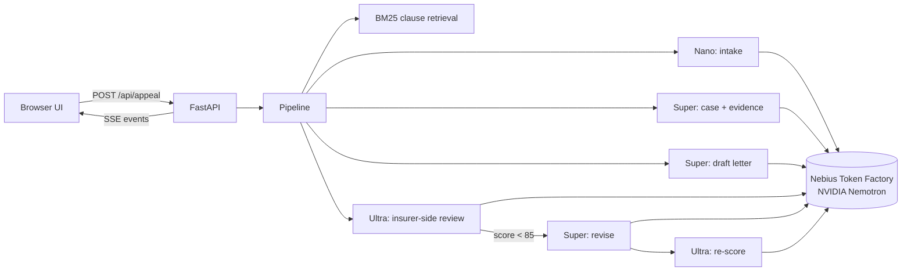

# AppealPilot

**Turn a health insurance denial into an evidence-backed appeal in about two minutes.**
AppealPilot runs NVIDIA Nemotron on Nebius Token Factory. Each step goes to the cheapest model that can do it well.

> Track: **Best Apps and Agents** · Nebius x NVIDIA Global AI Hackathon
> Live demo: `<add your deployed URL>` · Video: `<add YouTube link>`

---

## The problem

US insurers deny a large share of in-network claims, and almost nobody fights back. KFF's analysis of ACA
marketplace data found **fewer than 1% of denied claims are appealed**, while roughly **4 in 10 appeals that are filed succeed**.
People don't appeal because it's hard to do. You have to read a 200-page policy, find the clause the insurer had to follow,
match it to your medical records, cite your legal rights and write a formal letter before a deadline.
Professional patient advocates charge $100–$300 an hour to do this.

## What AppealPilot does

1. **Reads the denial**: insurer, claim, service, the quoted denial reason, the denial category and the appeal deadline (with a countdown).
2. **Finds the policy clauses that matter** in your plan document, even a long one.
3. **Builds the case**: arguments ranked by strength, each backed by a verbatim policy quote, a dated medical-record quote or a legal right
   (ACA appeal rights, the No Surprises Act, ERISA §503), plus a checklist of evidence you have and evidence you still need.
4. **Drafts a formal appeal letter** that's ready to print, with `[placeholders]` instead of invented facts.
5. **Attacks its own letter**: a second model plays the insurer's most skeptical reviewer. It scores the letter, writes the insurer's
   likely rebuttal and lists the weaknesses.
6. **Revises and re-scores**: if the score is below 85, the letter is rewritten to fix every weakness and checked again
   (sample case: **68 → 89**).

Everything streams live into the UI, including a **per-call routing trace** showing the model, latency, tokens and cost for each step.

## How we use NVIDIA Nemotron + Nebius Token Factory

The core design idea is **tiered routing**. Every model call goes through one router ([`app/llm.py`](app/llm.py)),
which maps a *tier* to a Nemotron model on Token Factory:

| Step | Tier | Why this tier |
|---|---|---|
| Intake & classification | **Nemotron 3 Nano** | Structured extraction is easy; Nano is fast and very cheap. |
| Clause retrieval | local BM25 | No model needed, and it keeps every later prompt small. |
| Case building | **Nemotron 3 Super** | Multi-document reasoning with strict citation rules. |
| Letter drafting / revision | **Nemotron 3 Super** | Long-form writing that follows format constraints. |
| Insurer-side review & re-score | **Nemotron 3 Ultra** *(reasoning on)* | The highest-stakes judgment in the pipeline: finding the holes before the insurer does. |

- **Model discovery:** the router calls Token Factory's OpenAI-compatible `/v1/models` and auto-selects the Nano, Super and Ultra
  Nemotron models. You can also pin them with `MODEL_NANO`, `MODEL_SUPER` and `MODEL_ULTRA`. If a tier is missing it falls back to the nearest tier and shows that in the trace.
- **Reasoning control:** thinking is switched off for extraction and drafting (for speed) and on for the Ultra review
  (`chat_template_kwargs.enable_thinking`).
- **Robust JSON:** structured stages use JSON mode. A malformed reply gets one repair pass on Nano.
- **Cost transparency:** each call's cost is shown next to what the same tokens would have cost on Ultra.
  `eval/run_eval.py` benchmarks routed vs. all-Ultra on cost, latency and judged quality.

### Benchmark

```
python -m eval.run_eval
```

Results are written to [`eval/results.md`](eval/results.md). *(Run this with your key and paste the table here before submitting.)*

## Architecture



```
appealpilot/
├── app/
│   ├── main.py        FastAPI: UI, samples, PDF/text upload, streaming /api/appeal
│   ├── pipeline.py    the 7-stage pipeline (async generator of events)
│   ├── llm.py         tiered Nemotron router, model discovery, cost trace
│   ├── retrieval.py   BM25 clause splitter/ranker for policy documents
│   ├── prompts.py     prompts for each stage
│   ├── samples.py     three fictional sample cases
│   └── mock.py        canned outputs for offline demo mode
├── static/
│   ├── pages/         landing, dashboard, new (wizard), case (workspace), rights, technology
│   ├── css/           app.css (design system from Figma tokens), landing.css, pages.css
│   └── js/            common.js (shell, case store, motion, SSE) + one script per page
├── eval/run_eval.py   routed vs. all-Ultra benchmark
└── Dockerfile
```

## Run it locally

Requires Python 3.11+.

```bash
git clone https://github.com/i-ayush-7/appealpilot.git && cd appealpilot
pip install -r requirements.txt
cp .env.example .env        # paste your NEBIUS_API_KEY
uvicorn app.main:app --reload --port 8000
```

Open http://localhost:8000. The landing page links into the app:

| Route | Page |
|---|---|
| `/` | Landing page |
| `/app` | Dashboard — cases, deadlines, amounts at stake |
| `/app/new` | New appeal wizard with a live Nemotron Nano intake preview |
| `/app/case?id=…` | Case workspace — streams the pipeline, letter, insurer review, routing ledger |
| `/app/rights` | Know your rights library |
| `/app/technology` | Models, pipeline and guardrails |

Cases are stored in the browser (`localStorage`); documents are never stored on the server.
The UI was designed in Figma first (design system + six screens) and built to match it.

**No key?** The app starts in **demo mode** and replays canned outputs for the spine MRI sample, so you can explore the full UI offline.
The badge in the top-right always shows whether you're in *Live* or *Demo* mode.

## Deploy on Nebius

The app is a single stateless container that listens on `$PORT` (default 8000).

```bash
docker build -t appealpilot .
docker run -p 8000:8000 -e NEBIUS_API_KEY=... appealpilot
```

To serve it from **Nebius Serverless Endpoints**, push the image to Nebius Container Registry, then create an endpoint from it
with port `8000` and `NEBIUS_API_KEY` set as a secret environment variable. *(Add the exact commands you used here.)*

## Running a public demo safely

A public URL means strangers can spend your Token Factory credits. AppealPilot bounds that:

| Safeguard | Default | Setting |
|---|---|---|
| Bundled sample cache — the three sample cases ship with their model responses (`app/seed_cache`), so sample runs cost $0 even on a fresh server | on | rebuild with `python -m eval.seed_samples` |
| Response cache — identical requests are replayed, never re-billed | on | `LLM_CACHE` |
| Daily spend cap (UTC day); visitors then see "today's live demo budget is used up — try a sample" | $1.50 | `DAILY_SPEND_USD` |
| Lifetime spend cap | $5 | `MAX_SPEND_USD` |
| Live appeals per visitor per hour (samples exempt) | 6 | `RUNS_PER_HOUR` |
| Letter-reading (intake) calls per visitor per hour | 30 | `INTAKES_PER_HOUR` |
| Live runs at once; extra runs queue, then fail politely | 2 | `MAX_CONCURRENT_RUNS` |
| Visitor identity — `X-Forwarded-For` is ignored unless you're behind a proxy | off | `TRUST_PROXY=1` behind a proxy |

The API key never reaches the browser. Spend tracking lives in `.cache/`; on hosts with ephemeral disks
it resets on redeploy, so also set a spending limit in Token Factory if your account offers one.

## Privacy

Documents are processed in memory for a single request and never written to disk or logged.
The only external calls go to Nebius Token Factory.

## Limitations

- Focused on US health insurance claim denials (internal appeals). External review requests and other denial types are on the roadmap.
- Scanned PDFs without a text layer have to be pasted as text for now (OCR is on the roadmap).
- AppealPilot drafts documents to help people use their appeal rights. **It is not legal or medical advice.** Users should check every fact
  and ideally include a letter of medical necessity from their doctor.

## Feedback on Nebius Token Factory & NVIDIA Nemotron

*(Required for submission. Write this from your own experience: model quality per tier, latency, JSON reliability, docs, onboarding and anything that slowed you down.)*

## Built during the hackathon

All code in this repository was written during the submission period.

## License

[MIT](LICENSE)
